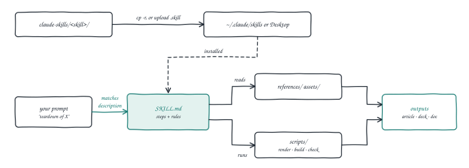

# claude-skills

A small, growing collection of [Claude Skills](https://docs.claude.com/en/docs/claude-code/skills) built for real work and released for anyone to use, adapt, and remix.

**Each skill is a fully self-contained folder.** Everything a skill needs — its manifest, references, build script, license, and README — lives inside its own directory. You can `git clone` this repo and cherry-pick a single skill folder into `~/.claude/skills/` without dragging the rest of the repo along. Skills are opinionated: they encode a specific way of doing a specific thing well, so you install one and get a good result on your first try.

**Status:** learning templates, shared as-is. Each skill encodes one way of doing one job well; read it, run it, and adapt it to your own work. They are not production-hardened tools.

**Live demo:** not applicable. Skills run inside your own Claude, so there is nothing to host.



*Fig. 1: How a skill runs. Claude does the writing; scripts only render, build or check.*

## Skills in this repo

| Skill | What it does |
|---|---|
| [`market-teardown/`](market-teardown/) | Turn your research on any market, product, or startup idea into a data-dense, verdict-driven teardown article (~1,500 words) plus a companion feed post. |
| [`linkedin-tech-carousel/`](linkedin-tech-carousel/) | Turn one technical topic into a 3-slide LinkedIn carousel — hook, mechanism, payoff — delivered as a swipeable PDF plus PNGs and ready-to-paste post copy. |
| [`demo-doc/`](demo-doc/) | Write a demo's design document in one house format — 10 numbered sections, a CoALA pipeline strip, hand-drawn SVG figures and fork/contribute links — as `DESIGN.md`, a styled HTML page and a website MDX post. |
| [`arch-doc/`](arch-doc/) | Explain a reference architecture as a concept ("what is an agent harness?") — 7 tutorial-style sections, 2–3 hand-drawn diagrams, links to demos that implement it, and a mandatory Credits & sources list that gives credit to the original sources. |

More skills will be added over time. See [CONTRIBUTING.md](CONTRIBUTING.md) if you want to propose one.

## What you can learn

- **How to write a skill that triggers reliably:** each `description:` names the outputs, the trigger phrases and two or three example prompts.
- **How to keep a long skill scannable:** `SKILL.md` holds the steps and rules; the deep detail sits in `references/`, read only when needed.
- **When to add code:** `linkedin-tech-carousel` renders slides with a Python script; `demo-doc` and `arch-doc` lint their figures with one. `market-teardown` needs no code at all.
- **How to package a skill:** every folder builds to a `.skill` archive with its own `build.sh`.

## Install a skill

Every skill in this repo works in both **Claude Code** (the CLI) and **Claude Desktop** (the app). Pick the one you use.

The examples below use `market-teardown`. Swap in whatever skill you're installing.

### 1) Claude Code

Copy the skill folder into your local skills directory:

```bash
git clone https://github.com/nitingoswami-io/claude-skills.git
cp -r claude-skills/market-teardown ~/.claude/skills/market-teardown
```

Restart Claude Code. It picks up the skill automatically — no separate enable step. The skill fires whenever your prompt matches the trigger phrases in its `description:` frontmatter (see the skill's own README for example prompts).

### 2) Claude Desktop

Two easy paths — Option A is the fastest.

**Option A — Ask Claude to install it for you.**

1. Open a new chat in Claude Desktop.
2. **Drag the entire `market-teardown/` folder into the chat** — or attach it with the paperclip / `+` button. Make sure you attach the folder itself, not just `SKILL.md` — this skill has supporting files under `references/` and `assets/` that need to be included, and pasting `SKILL.md` alone will drop them.
3. Say: *"Please install this as a skill."*

Claude will validate the frontmatter, show you a review card, and save it in one click. This is the easiest way and catches formatting mistakes before upload.

**Option B — Upload the zip yourself.**

1. Build the `.skill` archive using the skill's own build script:
   ```bash
   git clone https://github.com/nitingoswami-io/claude-skills.git
   cd claude-skills/market-teardown
   ./build.sh
   ```
   That produces `dist/market-teardown.skill` inside the skill folder.
2. In Claude Desktop, go to **Settings → Capabilities → Skills**, click **Upload skill**, and choose the file. (Menu names may vary slightly by app version.)
3. Wait ~1–2 minutes for the security scan.
4. When the skill turns green, toggle it on.
5. Test it in a new chat — e.g. *"teardown of on-device inference economics"* — and the skill should fire.

**If the skill doesn't fire**, check that **Code execution and file creation** is enabled under Settings — skills require it.

**Updating a skill you already installed?** Just upload the new `.skill` file in its place; it replaces the previous version.

**Common mistakes** (from Anthropic's own guidance):

- Zip structure — the archive must contain the skill *folder* at its root, not the loose files. Each skill's `build.sh` gets this right for you.
- Frontmatter — `SKILL.md` must start with a valid YAML `---` block that has both `name` and `description`.
- `name` field — lowercase and hyphens only, no spaces or capitals.
- `description` field — must be specific enough that Claude knows when to trigger it.

## Repo layout

```
claude-skills/
├── README.md                 # you are here — index of skills
├── LICENSE                   # MIT (covers the repo as a whole)
├── CONTRIBUTING.md           # how to propose changes or new skills
├── scripts/check_skills.py   # checks every skill folder (run by CI)
├── docs/figures/             # figures used in this README
├── .github/                  # CI, issue and PR templates
└── <skill-name>/             # one directory per skill — fully self-contained
    ├── SKILL.md              # manifest + instructions (required)
    ├── README.md             # human-facing docs (required)
    ├── LICENSE               # MIT (travels with the folder)
    ├── build.sh              # zips this folder into dist/<name>.skill
    ├── references/           # supporting docs Claude reads on demand
    ├── assets/ or examples/  # templates, sample inputs, etc.
    └── scripts/              # optional: runnable code the skill invokes
```

Each skill directory is the source of truth. Zipped `.skill` bundles are build artifacts and are gitignored.

## How it works

Claude loads only each skill's name and `description:` at the start. When your prompt matches a description, Claude reads that skill's `SKILL.md` and follows it, opening files in `references/` or `assets/` and running `scripts/` only when a step says to (Fig. 1).

No skill here needs an API key or environment variables. `linkedin-tech-carousel` needs Python 3 and matplotlib (`requirements.txt`); `demo-doc` and `arch-doc` use Python 3 for their figure checks. The others are instructions only.

## Adapting a skill

- **Change when it fires:** edit the `description:` in `SKILL.md`.
- **Change the format or voice:** edit the rules in `SKILL.md` and the templates in `assets/`.
- **Change the look:** `linkedin-tech-carousel` themes live in `scripts/render_deck.py`; the `demo-doc` and `arch-doc` palettes live in their `references/`.
- **Make it yours:** copy the folder, rename it (the folder name and `name:` must match), and run `python3 scripts/check_skills.py`.

## Known limits

- Output quality depends on the model and on the material you give it. `market-teardown` refuses to write without enough sourced figures, by design.
- The figure checks catch long labels, not layout mistakes. Look at the rendered figures.
- Claude Desktop menu names in the install steps may differ between app versions.

## Contributing

Issues and pull requests are welcome: fork, branch, run `python3 scripts/check_skills.py`, and open a PR. See [CONTRIBUTING.md](CONTRIBUTING.md).

## Why open-source

Good skills are hard to write. The craft is in the instructions — the small structural rules and refusals that separate a competent output from a generic one. Publishing them lets other people benefit from that work, and lets me improve mine by learning from how they get adapted.

If you extend one of these skills or build something interesting on top, I'd love to see it. Open an issue or PR.

## License

MIT. See [LICENSE](LICENSE). Use freely, credit appreciated but not required.

## Author

By [Nitin Goswami](https://github.com/nitingoswami-io). Feedback, issues, and pull requests welcome.
