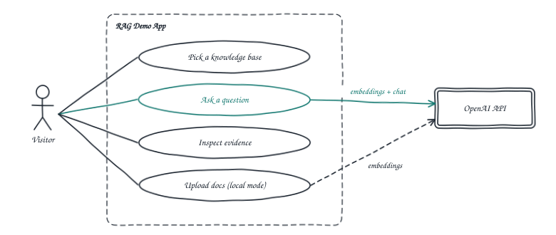
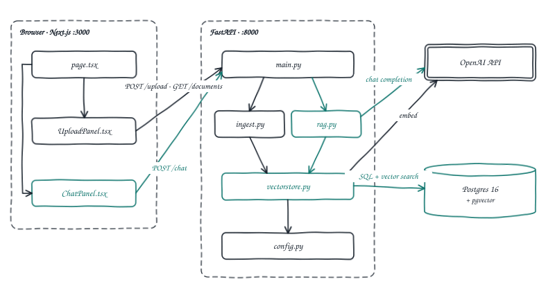
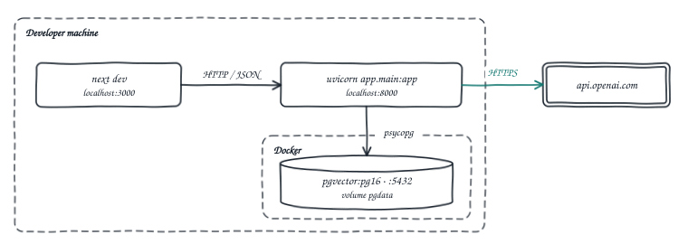
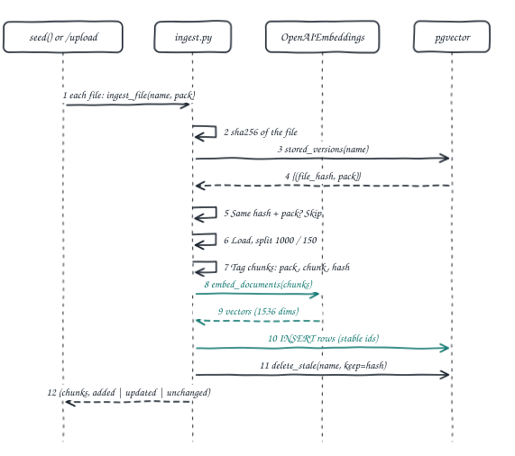
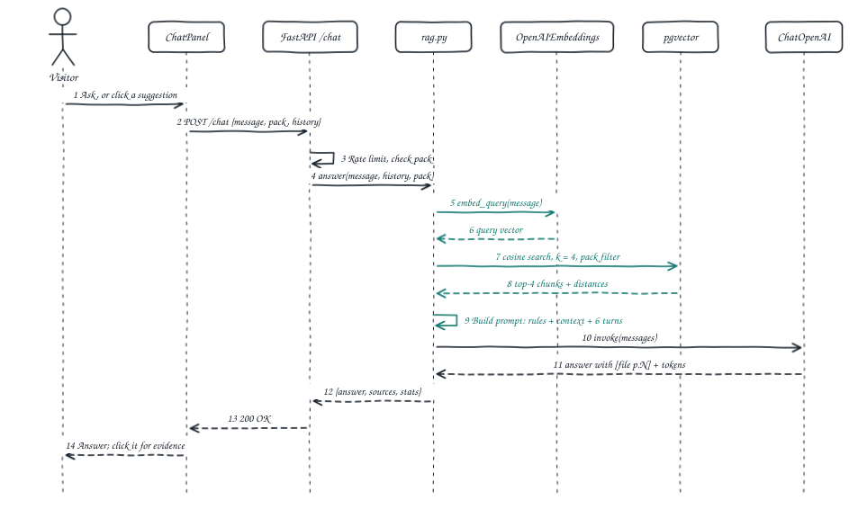
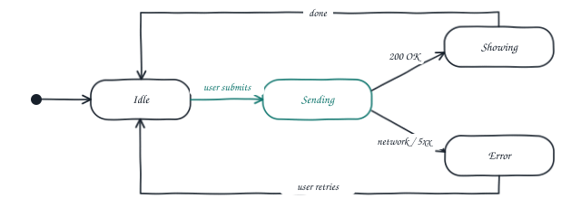
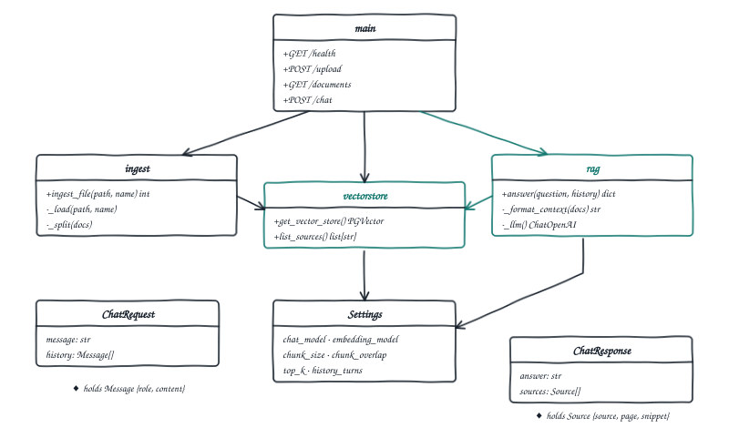
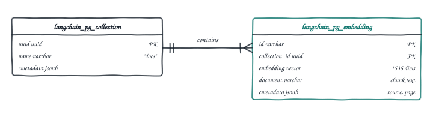
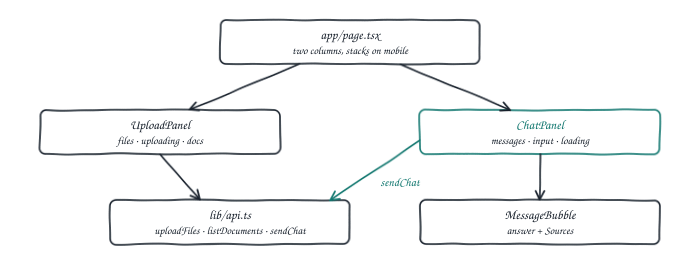

# RAG Demo: upload documents, chat with them

`DESIGN DOCUMENT · rag-demo`

*A minimal web app that shows semantic Retrieval-Augmented Generation end to end. Each stage, from chunking to grounded answers, is visible in the UI and maps to the CoALA framework.*

| Stack | Models | Date | Status |
|---|---|---|---|
| FastAPI · LangChain · pgvector · Next.js | `gpt-4o-mini` · `text-embedding-3-small` | 17 Oct 2026 | Approved · built |

[View code](https://github.com/nitingoswami-io/rag-demo) · [Fork](https://github.com/nitingoswami-io/rag-demo/fork) · [Report an issue](https://github.com/nitingoswami-io/rag-demo/issues/new) · [Contribute](https://github.com/nitingoswami-io/rag-demo/blob/main/CONTRIBUTING.md)

---

## 1. Purpose & scope

The app is a learning tool. The ingestion pipeline fills a long-term **semantic memory** (pgvector). Each chat turn runs a **retrieval action** that copies the most relevant chunks into the model's **working memory** (the prompt).

**CoALA pipeline**

| Stage | Key | Does | CoALA role |
|---|---|---|---|
| 1 | `POST /upload` | Chunk · embed · store | CoALA learning action |
| 2 | `pgvector` | Vector collection | Semantic memory (long-term) |
| 3 | `similarity_search` | Top-4 chunks | Retrieval action |
| 4 | `ChatPromptTemplate` | Context + history | Working memory |
| 5 | `ChatOpenAI` | Grounded answer | Reasoning → external action |

### In scope

- Upload `.pdf`, `.txt` and `.md` files and index them into pgvector.
- List the indexed documents.
- A chat agent that answers only from the documents and shows its sources (file, page, snippet).
- Short chat history, kept on the client and sent with each request.

### Out of scope

Authentication, multi-user isolation, streaming, document deletion, reranking, hybrid search and production deployment. Section 10 lists these as follow-ups.

## 2. Use cases



*Fig. 1: Use case diagram: one actor, four use cases, one external system.*

| ID  | Use case               | Behaviour                                                                                                         |
| --- | ---------------------- | ----------------------------------------------------------------------------------------------------------------- |
| UC1 | Upload documents       | The user picks files. The system chunks, embeds and stores them, then shows how many chunks were indexed per file. |
| UC2 | View indexed documents | Lists the distinct source filenames in the vector store.                                                          |
| UC3 | Ask a question         | Retrieves the top-4 chunks. The LLM answers from them only, or replies "I don't know based on the uploaded documents." |
| UC4 | Inspect sources        | Each answer lists the chunks it used (file, page, snippet), so retrieval is visible.                              |

## 3. Architecture

The system has three runtime parts: a Next.js client, a FastAPI service that owns all LangChain logic, and Postgres with the pgvector extension. OpenAI provides the embedding and chat models.



*Fig. 2: Component diagram: modules and their dependencies.*



*Fig. 3: Deployment view for local development.*

## 4. Key flows

### 4.1 Ingestion: upload → chunk → embed → store



*Fig. 4: Sequence: ingestion (CoALA learning action).*

### 4.2 Query: question → retrieve → generate



*Fig. 5: Sequence: one chat turn (retrieval → working memory → reasoning).*

### 4.3 Chat request lifecycle



*Fig. 6: State diagram for the chat panel.*

## 5. Backend design



*Fig. 7: Class diagram: Python modules and Pydantic models.*

| File                  | Responsibility                                                                                                                               |
| --------------------- | -------------------------------------------------------------------------------------------------------------------------------------------- |
| `app/config.py`       | Loads `.env` and exposes a frozen `Settings` dataclass.                                                                                      |
| `app/vectorstore.py`  | Cached `PGVector` (collection `docs`, JSONB metadata) using `OpenAIEmbeddings`, plus the distinct-sources query.                             |
| `app/ingest.py`       | Picks a loader by file extension, splits with `RecursiveCharacterTextSplitter`, tags `source` and a 1-based `page`, then calls `add_documents`. |
| `app/rag.py`          | Runs `similarity_search(k=4)`, builds the prompt with `ChatPromptTemplate` and `MessagesPlaceholder`, calls `ChatOpenAI(temperature=0)`, and returns the answer and sources. |
| `app/main.py`         | FastAPI routes, CORS for `localhost:3000`, request and response models, and error mapping.                                                   |

### System prompt

```text
You are a helpful assistant for a document Q&A demo.
Answer the question using ONLY the context below.
If the answer is not in the context, reply exactly:
"I don't know based on the uploaded documents."
Cite sources inline as [filename p.N].

Context:
{context}
```

### API contract

| Method | Path         | Request                                       | Response                                       |
| ------ | ------------ | --------------------------------------------- | ---------------------------------------------- |
| GET    | `/health`    | n/a                                           | `{"status":"ok"}`                              |
| POST   | `/upload`    | multipart, field `files` (1..n)               | `[{"filename","chunks"}]`                      |
| GET    | `/documents` | n/a                                           | `["a.pdf", …]`                                 |
| POST   | `/chat`      | `{"message","history":[{"role","content"}]}`  | `{"answer","sources":[{"source","page","snippet"}]}` |

Errors: `400` for an unsupported file type or an empty message. `500` with a readable `detail` for OpenAI or database failures.

## 6. Data model

`langchain-postgres` creates the `vector` extension and both tables on first use, so no migrations are needed. Each chunk is one row: its text, its 1536-dimension embedding and JSONB metadata.



*Fig. 8: Entity-relationship diagram of the vector store tables.*

## 7. Frontend design



*Fig. 9: Frontend component tree.*

- Client components (`"use client"`) with Tailwind v4. No extra packages beyond the `create-next-app` defaults.
- Plain `fetch` to `NEXT_PUBLIC_API_URL` (default `http://localhost:8000`).
- Each assistant reply has a collapsible Sources list showing the retrieved chunks.

## 8. Project layout

```text
rag-demo/
├── docker-compose.yml        pgvector/pgvector:pg16
├── README.md
├── docs/DESIGN.md            this document (Markdown + Mermaid)
├── backend/
│   ├── requirements.txt
│   ├── .env.example          OPENAI_API_KEY, DATABASE_URL
│   ├── sample/sample.md      example handbook to upload
│   └── app/  config · vectorstore · ingest · rag · main
└── frontend/
    ├── lib/api.ts
    └── app/  page.tsx · components/{UploadPanel, ChatPanel, MessageBubble}.tsx
```

## 9. Run & verify

```bash
git clone https://github.com/nitingoswami-io/rag-demo.git && cd rag-demo
docker compose up -d
cd backend && python3.12 -m venv .venv && source .venv/bin/activate
pip install -r requirements.txt && cp .env.example .env   # add OPENAI_API_KEY
uvicorn app.main:app --reload                              # :8000, docs at /docs
cd ../frontend && cp .env.local.example .env.local         # NEXT_PUBLIC_API_URL
npm install && npm run dev                                 # :3000
```

| Check                                           | Expected                                                                                  |
| ----------------------------------------------- | ----------------------------------------------------------------------------------------- |
| `GET /health`                                   | `{"status":"ok"}`                                                                         |
| Upload `sample/sample.md`                       | Chunk count greater than 0. The file appears under Indexed documents.                     |
| "How many weeks of parental leave do I get?"    | 18 weeks for the primary caregiver and 6 for the secondary, cited as `[sample.md]`        |
| "Who won the 2022 World Cup?"                   | "I don't know based on the uploaded documents."                                           |
| Upload a `.csv`                                 | `400` with "only .pdf, .txt and .md are supported."                                       |

## 10. Next steps

| Idea                                                  | What it teaches                                          |
| ----------------------------------------------------- | -------------------------------------------------------- |
| Hybrid search (BM25 + vector) and a reranker          | The largest retrieval-quality gain in real systems       |
| Agentic RAG: let the agent decide when to retrieve    | CoALA decision procedure instead of a fixed pipeline     |
| Persist chat history in Postgres and retrieve it      | Episodic memory alongside semantic memory                |
| Streaming answers over SSE                            | Responsive UX for long answers                           |
| Delete and re-index documents, per-user collections   | Memory management and access control                     |

### Contribute

Fork the repo, pick an idea from the table, and open a pull request. Bugs and unclear steps go in [issues](https://github.com/nitingoswami-io/rag-demo/issues/new); the workflow is in [CONTRIBUTING.md](../CONTRIBUTING.md).

## Credits & sources

1. Theodore R. Sumers, Shunyu Yao, Karthik Narasimhan, Thomas L. Griffiths. [*Cognitive Architectures for Language Agents*](https://arxiv.org/abs/2309.02427) (2023). The CoALA vocabulary (semantic and working memory, retrieval and learning actions) used to map each RAG stage.
2. [*pgvector — open-source vector similarity search for Postgres*](https://github.com/pgvector/pgvector). The vector store behind ingestion and similarity search.

---

rag-demo · design document · source of truth: `docs/DESIGN.md` in the repository.
